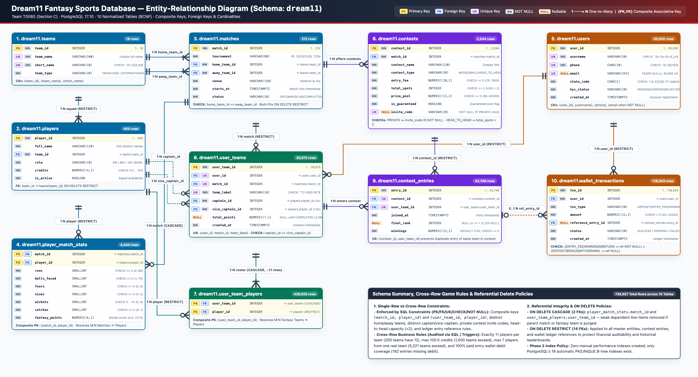
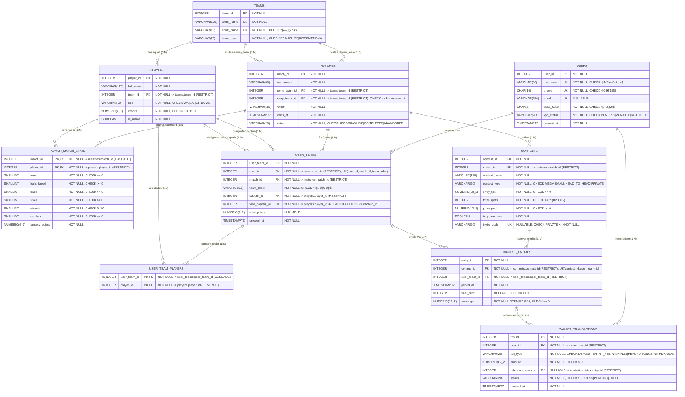

# 02 — Schema Design & Data Integrity Report

**Project:** Dream11 Fantasy Sports Database  
**Course:** Database Management Systems  
**Team:** T0060 · **Section:** C  
**Database Engine:** PostgreSQL 17.10 (Compatible with PostgreSQL 15+)  
**Phase:** 2 — Relational Schema Reconstruction, Normalization, Data Loading & Integrity Verification

---

## A. Schema Overview

The Dream11 Fantasy Sports Database models the core operational and analytical domains of a fantasy cricket platform inside a dedicated PostgreSQL schema named `dream11` (`CREATE SCHEMA dream11; SET search_path TO dream11;`).

Because the legacy system lacked schema documentation and left behind only raw CSV exports (`seed_data/*.csv`, totaling **738,657 rows** across 10 files), we inspected the exact headers, distinct values, value ranges, null patterns, candidate keys, and cross-table references across all 10 files before designing [`sql/01_schema.sql`](../sql/01_schema.sql).

The 10 relational entities fall into four logical domains:

1. **Real Cricket Entities (`teams`, `players`, `matches`, `player_match_stats`):**
   - **`teams` (18 rows):** Master table of real cricket squads (10 IPL franchises and 8 international national teams).
   - **`players` (450 rows):** Real cricket players (25-player squads per team) with playing role (`WK`, `BAT`, `AR`, `BOWL`), selection credit cost (`6.5` to `10.5`), and active status.
   - **`matches` (212 rows):** Scheduled fixtures across 5 tournaments from March 2025 to July 2026, linking a home team and an away team, venue, start timestamp (`TIMESTAMPTZ`), and match lifecycle status (`UPCOMING`, `LIVE`, `COMPLETED`, `ABANDONED`).
   - **`player_match_stats` (4,444 rows):** Associative scorecard entity recording each participating player's batting, bowling, and fielding statistics in a match alongside their computed `fantasy_points`.
2. **User & Compliance Profile (`users`):**
   - **`users` (50,000 rows):** Registered platform accounts with unique `username`, unique 10-digit Indian mobile `phone`, optional unique `email`, 2-letter Indian `state_code` (used for paid-contest state compliance checks), and `kyc_status` (`PENDING`, `VERIFIED`, `REJECTED`).
3. **Fantasy Team Construction (`user_teams`, `user_team_players`):**
   - **`user_teams` (39,975 rows):** User-created fantasy teams for a specific match, labeled `T1`, `T2`, `T3`, etc., designating a `captain_id` (2× points) and `vice_captain_id` (1.5× points), and caching `total_points` once the match is completed.
   - **`user_team_players` (439,925 rows):** Associative roster table mapping each fantasy team to its selected players.
4. **Contests & Financial Wallet Ledger (`contests`, `contest_entries`, `wallet_transactions`):**
   - **`contests` (2,544 rows):** Public and private fantasy competitions attached to matches (`MEGA`, `SMALL`, `HEAD_TO_HEAD`, `PRIVATE`), specifying `entry_fee`, `total_spots`, `prize_pool`, `is_guaranteed`, and `invite_code` (for private leagues).
   - **`contest_entries` (42,746 rows):** Junction entity recording which `user_team_id` joined which `contest_id`, when it joined (`joined_at`), its post-match `final_rank`, and prize `winnings`.
   - **`wallet_transactions` (118,343 rows):** Append-oriented financial ledger recording `DEPOSIT`, `ENTRY_FEE`, `WINNINGS`, `REFUND`, `BONUS`, and `WITHDRAWAL` transactions with status (`SUCCESS`, `PENDING`, `FAILED`) and optional `reference_entry_id` tying contest-related transactions back to `contest_entries`.

### Summary of Enforced Database Constraints

All constraints in [`sql/01_schema.sql`](../sql/01_schema.sql) were verified against 100% of the seed dataset and cataloged from `pg_constraint` and `information_schema.columns`:

| Constraint Category | Count | Details |
|---|---:|---|
| **PRIMARY KEY** | 10 | 8 single-column PKs + 2 composite PKs (`player_match_stats`, `user_team_players`) |
| **FOREIGN KEY** | 16 | 14 with `ON DELETE RESTRICT`, 2 with `ON DELETE CASCADE` |
| **UNIQUE** | 8 | `teams(team_name)`, `teams(short_name)`, `users(username)`, `users(phone)`, `users(email)`, `user_teams(user_id, match_id, team_label)`, `contests(invite_code)`, `contest_entries(contest_id, user_team_id)` |
| **CHECK** | 24 | 24 named `CHECK` clauses (enforcing 31 distinct domain, range, regex, and cross-column predicates) |
| **NOT NULL** | 60 | 60 of 65 total columns across the 10 tables are `NOT NULL` (only 5 columns are nullable) |

**Phase 2 Index Policy:** In accordance with Phase 2 rules, **zero manually tuned performance indexes** were created. Only the **18 automatic B-tree indexes** generated by PostgreSQL to back the 10 `PRIMARY KEY` and 8 `UNIQUE` constraints exist in the schema.

---

## B. Data Dictionary

Every column across all 10 tables is documented below with its exact PostgreSQL data type, nullability, keys/constraints, observed seed-data characteristics, and design rationale.

### 1. `dream11.teams` (18 rows)

Stores real cricket teams (IPL franchises and international national squads).

| Column | PostgreSQL Type | Nullability | Keys & Constraints | Why the Type & Constraint Exist (Validated Against CSV) |
|---|---|---|---|---|
| `team_id` | `INTEGER` | `NOT NULL` | `PRIMARY KEY (pk_teams)` | Surrogate integer identifier (`1` to `18`). Uniquely identifies each real cricket team. |
| `team_name` | `VARCHAR(100)` | `NOT NULL` | `UNIQUE (uq_teams_team_name)` | Official team name (observed length `5` to `27`, e.g., `'Chennai Super Kings'`). No two teams can share the same full name. |
| `short_name` | `VARCHAR(10)` | `NOT NULL` | `UNIQUE (uq_teams_short_name)`, `CHECK (short_name ~ '^[A-Z]{2,5}$')` | Abbreviated team code (`2` to `4` uppercase letters in CSV, e.g., `'CSK'`, `'PBKS'`, `'IND'`). Used directly in UI fixtures (R01) and filters (R24). |
| `team_type` | `VARCHAR(20)` | `NOT NULL` | `CHECK (team_type IN ('FRANCHISE', 'INTERNATIONAL'))` | Classifies the team as either an IPL franchise (10 rows) or national team (8 rows). Queried in R19 (`team_type = 'FRANCHISE'`). |

### 2. `dream11.players` (450 rows)

Stores real cricket players, their squad assignment, playing role, credit cost, and active status.

| Column | PostgreSQL Type | Nullability | Keys & Constraints | Why the Type & Constraint Exist (Validated Against CSV) |
|---|---|---|---|---|
| `player_id` | `INTEGER` | `NOT NULL` | `PRIMARY KEY (pk_players)` | Unique player identifier (`1` to `450`, 25 players per team). |
| `full_name` | `VARCHAR(120)` | `NOT NULL` | `NOT NULL` (Not Unique) | Player display name (length `8` to `16`). **Not unique**: 450 rows have 330 distinct names because different players can share the same name in real life. |
| `team_id` | `INTEGER` | `NOT NULL` | `FOREIGN KEY (fk_players_team) REFERENCES teams(team_id) ON DELETE RESTRICT` | Links each player to their real squad (`1` to `18`). `ON DELETE RESTRICT` prevents deleting a team that still has registered players. |
| `role` | `VARCHAR(10)` | `NOT NULL` | `CHECK (role IN ('WK', 'BAT', 'AR', 'BOWL'))` | Enforces the four standard Dream11 cricket roles: Wicket-Keeper, Batter, All-Rounder, Bowler. |
| `credits` | `NUMERIC(4,1)` | `NOT NULL` | `CHECK (credits BETWEEN 5.0 AND 15.0)` | Exact decimal cost to pick the player (observed values: `6.5` to `10.5` in `0.5` increments). `NUMERIC` avoids floating-point rounding errors when summing credits against the 100-credit cap (R06). |
| `is_active` | `BOOLEAN` | `NOT NULL` | `NOT NULL` | Native boolean (`t`/`f` in CSV) indicating whether the player is active and selectable in the match pool (R02). |

### 3. `dream11.matches` (212 rows)

Stores real cricket fixtures, participating teams, venue, scheduled start time, and lifecycle status.

| Column | PostgreSQL Type | Nullability | Keys & Constraints | Why the Type & Constraint Exist (Validated Against CSV) |
|---|---|---|---|---|
| `match_id` | `INTEGER` | `NOT NULL` | `PRIMARY KEY (pk_matches)` | Unique fixture identifier (`1` to `212`). |
| `tournament` | `VARCHAR(80)` | `NOT NULL` | `NOT NULL` | Series/tournament name (5 distinct values, length `8` to `21`, e.g., `'IPL 2026'`, `'World T20 Series 2025'`). Queried in R12. |
| `home_team_id` | `INTEGER` | `NOT NULL` | `FOREIGN KEY (fk_matches_home_team) REFERENCES teams(team_id) ON DELETE RESTRICT` | Home team identifier (`1` to `18`). `RESTRICT` protects historical match records if a team deletion is attempted. |
| `away_team_id` | `INTEGER` | `NOT NULL` | `FOREIGN KEY (fk_matches_away_team) REFERENCES teams(team_id) ON DELETE RESTRICT`, `CHECK (home_team_id <> away_team_id)` | Away team identifier (`1` to `18`). Cross-column `CHECK (home_team_id <> away_team_id)` prevents a team from playing against itself. |
| `venue` | `VARCHAR(150)` | `NOT NULL` | `NOT NULL` | Stadium and city name (17 distinct venues, length `5` to `24`, e.g., `'Wankhede, Mumbai'`). |
| `starts_at` | `TIMESTAMPTZ` | `NOT NULL` | `NOT NULL` | Scheduled match start time with timezone offset (`+05:30`). Stored as `TIMESTAMPTZ` for accurate timezone-aware comparisons and sorting. |
| `status` | `VARCHAR(20)` | `NOT NULL` | `CHECK (status IN ('UPCOMING', 'LIVE', 'COMPLETED', 'ABANDONED'))` | Enforces valid match lifecycle states. Used in lobby filtering (R01), analytics (R14), and abandoned-match refund audits (R25). |

### 4. `dream11.player_match_stats` (4,444 rows)

Stores per-match player performance statistics and calculated fantasy points.

| Column | PostgreSQL Type | Nullability | Keys & Constraints | Why the Type & Constraint Exist (Validated Against CSV) |
|---|---|---|---|---|
| `match_id` | `INTEGER` | `NOT NULL` | `PRIMARY KEY (match_id, player_id)`, `FOREIGN KEY (fk_pms_match) REFERENCES matches(match_id) ON DELETE CASCADE` | Part 1 of composite PK. `ON DELETE CASCADE` is chosen because scorecard lines are weak dependent details of a match. |
| `player_id` | `INTEGER` | `NOT NULL` | `PRIMARY KEY (match_id, player_id)`, `FOREIGN KEY (fk_pms_player) REFERENCES players(player_id) ON DELETE RESTRICT` | Part 2 of composite PK. Ensures a player has at most one stat line per match. `RESTRICT` prevents deleting a player with recorded match stats. |
| `runs` | `SMALLINT` | `NOT NULL` | `CHECK (runs >= 0)` | Runs scored by the player in the match (observed `0` to `69`). `SMALLINT` (2 bytes) saves space over `INTEGER` for bounded match counts. |
| `balls_faced` | `SMALLINT` | `NOT NULL` | `CHECK (balls_faced >= 0)` | Deliveries faced by the player (observed `1` to `70`). Cannot be negative. |
| `fours` | `SMALLINT` | `NOT NULL` | `CHECK (fours >= 0)` | Boundary fours hit (observed `0` to `5`). Cannot be negative. |
| `sixes` | `SMALLINT` | `NOT NULL` | `CHECK (sixes >= 0)` | Boundary sixes hit (observed `0` to `2`). Cannot be negative. |
| `wickets` | `SMALLINT` | `NOT NULL` | `CHECK (wickets >= 0 AND wickets <= 10)` | Wickets taken by the bowler in a single innings/match (observed `0` to `4`; in cricket a bowler can take at most 10 wickets in an innings). |
| `catches` | `SMALLINT` | `NOT NULL` | `CHECK (catches >= 0)` | Catches taken in the field (observed `0` to `1`). Cannot be negative. |
| `fantasy_points` | `NUMERIC(6,1)` | `NOT NULL` | `NOT NULL` | Total fantasy score earned by the player in the match (observed `4.0` to `127.0`). Stored as `NUMERIC(6,1)` (no `CHECK >= 0` is imposed on `fantasy_points` because in Dream11 rules a duck or low economy can theoretically yield negative points, even though minimum in seed data is `4.0`). |

### 5. `dream11.users` (50,000 rows)

Stores registered Dream11 user accounts, contact identifiers, state residence, and KYC verification status.

| Column | PostgreSQL Type | Nullability | Keys & Constraints | Why the Type & Constraint Exist (Validated Against CSV) |
|---|---|---|---|---|
| `user_id` | `INTEGER` | `NOT NULL` | `PRIMARY KEY (pk_users)` | Unique user account identifier (`1` to `50,000`). |
| `username` | `VARCHAR(50)` | `NOT NULL` | `UNIQUE (uq_users_username)`, `CHECK (username ~ '^[A-Za-z0-9_]+$')` | Unique alphanumeric/underscore user handle (observed length `10` to `25`, 50,000 distinct values). |
| `phone` | `CHAR(10)` | `NOT NULL` | `UNIQUE (uq_users_phone)`, `CHECK (phone ~ '^[0-9]{10}$')` | 10-digit mobile number used for login (R23). Stored as character string (`CHAR(10)`) rather than integer because phone numbers are identifiers, not quantities. |
| `email` | `VARCHAR(254)` | `NULL` | `UNIQUE (uq_users_email)` | Optional email address (`19,935` rows are `NULL`; all `30,065` non-null emails are unique). PostgreSQL standard `UNIQUE` allows multiple `NULL`s while enforcing uniqueness on all present emails. |
| `state_code` | `CHAR(2)` | `NOT NULL` | `CHECK (state_code ~ '^[A-Z]{2}$')` | 2-letter uppercase Indian state code (17 distinct values in seed data, e.g., `'TN'`, `'AP'`, `'MH'`). Used in regulatory compliance queries (R11). |
| `kyc_status` | `VARCHAR(20)` | `NOT NULL` | `CHECK (kyc_status IN ('PENDING', 'VERIFIED', 'REJECTED'))` | Tracks KYC verification state for tax/withdrawal compliance (R18). |
| `created_at` | `TIMESTAMPTZ` | `NOT NULL` | `NOT NULL` | Account registration timestamp with timezone offset. |

### 6. `dream11.user_teams` (39,975 rows)

Stores fantasy teams created by users for specific matches.

| Column | PostgreSQL Type | Nullability | Keys & Constraints | Why the Type & Constraint Exist (Validated Against CSV) |
|---|---|---|---|---|
| `user_team_id` | `INTEGER` | `NOT NULL` | `PRIMARY KEY (pk_user_teams)` | Unique identifier for each created fantasy team (`1` to `39,975`). |
| `user_id` | `INTEGER` | `NOT NULL` | `FOREIGN KEY (fk_user_teams_user) REFERENCES users(user_id) ON DELETE RESTRICT`, `UNIQUE (user_id, match_id, team_label)` | Owner of the fantasy team. `RESTRICT` prevents deleting users who own historical fantasy teams. |
| `match_id` | `INTEGER` | `NOT NULL` | `FOREIGN KEY (fk_user_teams_match) REFERENCES matches(match_id) ON DELETE RESTRICT`, `UNIQUE (user_id, match_id, team_label)` | Match for which the fantasy team was built. `RESTRICT` preserves teams tied to matches. |
| `team_label` | `VARCHAR(10)` | `NOT NULL` | `CHECK (team_label ~ '^T[1-9][0-9]*$')`, `UNIQUE (user_id, match_id, team_label)` | User-facing team label (`'T1'`, `'T2'`, `'T3'` in seed data; `'T9'` in W01). Composite `UNIQUE (user_id, match_id, team_label)` ensures a user cannot create two teams with the same label for the same match. |
| `captain_id` | `INTEGER` | `NOT NULL` | `FOREIGN KEY (fk_user_teams_captain) REFERENCES players(player_id) ON DELETE RESTRICT` | Designated captain receiving 2× points (R07, R08, W04). `RESTRICT` protects player reference. |
| `vice_captain_id` | `INTEGER` | `NOT NULL` | `FOREIGN KEY (fk_user_teams_vice_captain) REFERENCES players(player_id) ON DELETE RESTRICT`, `CHECK (captain_id <> vice_captain_id)` | Designated vice-captain receiving 1.5× points. Cross-column `CHECK (captain_id <> vice_captain_id)` enforces the rule that captain and vice-captain must be different players. |
| `total_points` | `NUMERIC(7,1)` | `NULL` | `NULL` allowed | Aggregated team fantasy score (`14.0` to `820.5` for completed matches). **Nullable** because `2,098` teams belong to `UPCOMING` (1,409), `LIVE` (226), or `ABANDONED` (463) matches where final points are not yet computed (also `NULL` on initial creation in W01). |
| `created_at` | `TIMESTAMPTZ` | `NOT NULL` | `NOT NULL` | Timestamp when the fantasy team was saved. |

### 7. `dream11.user_team_players` (439,925 rows)

Associative table recording the players selected in each fantasy team's roster.

| Column | PostgreSQL Type | Nullability | Keys & Constraints | Why the Type & Constraint Exist (Validated Against CSV) |
|---|---|---|---|---|
| `user_team_id` | `INTEGER` | `NOT NULL` | `PRIMARY KEY (user_team_id, player_id)`, `FOREIGN KEY (fk_utp_user_team) REFERENCES user_teams(user_team_id) ON DELETE CASCADE` | Part 1 of composite PK. `ON DELETE CASCADE` ensures that if a fantasy team is deleted before lock, its roster line-items are automatically cleaned up. |
| `player_id` | `INTEGER` | `NOT NULL` | `PRIMARY KEY (user_team_id, player_id)`, `FOREIGN KEY (fk_utp_player) REFERENCES players(player_id) ON DELETE RESTRICT` | Part 2 of composite PK. Prevents the same player from being picked twice in the same fantasy team. `ON DELETE RESTRICT` prevents deleting a player referenced in any roster. |

### 8. `dream11.contests` (2,544 rows)

Stores contests offered for each match.

| Column | PostgreSQL Type | Nullability | Keys & Constraints | Why the Type & Constraint Exist (Validated Against CSV) |
|---|---|---|---|---|
| `contest_id` | `INTEGER` | `NOT NULL` | `PRIMARY KEY (pk_contests)` | Unique contest identifier (`1` to `2,544`). |
| `match_id` | `INTEGER` | `NOT NULL` | `FOREIGN KEY (fk_contests_match) REFERENCES matches(match_id) ON DELETE RESTRICT` | Match to which the contest belongs. `RESTRICT` prevents deleting a match that has associated contests. |
| `contest_name` | `VARCHAR(120)` | `NOT NULL` | `NOT NULL` | Contest display name (12 distinct names, e.g., `'Mega Contest'`, `'Head to Head 7'`). |
| `contest_type` | `VARCHAR(20)` | `NOT NULL` | `CHECK (contest_type IN ('MEGA', 'SMALL', 'HEAD_TO_HEAD', 'PRIVATE'))` | Enforces the 4 valid contest categories. |
| `entry_fee` | `NUMERIC(10,2)` | `NOT NULL` | `CHECK (entry_fee >= 0)` | Exact monetary entry fee in INR (observed `25.00` to `1000.00`; `>= 0` supports free practice contests as implied by `c.entry_fee > 0` in R11, R13, R25). |
| `total_spots` | `INTEGER` | `NOT NULL` | `CHECK (total_spots >= 2)`, `CHECK (contest_type <> 'HEAD_TO_HEAD' OR total_spots = 2)` | Maximum contest capacity (`2` to `2,000`). Cross-column `CHECK` ensures every `HEAD_TO_HEAD` contest has exactly 2 spots. |
| `prize_pool` | `NUMERIC(12,2)` | `NOT NULL` | `CHECK (prize_pool >= 0)` | Total prize money on offer in INR (`85.00` to `83,300.00`). |
| `is_guaranteed` | `BOOLEAN` | `NOT NULL` | `NOT NULL` | Boolean flag indicating whether the prize pool is guaranteed regardless of fill rate. |
| `invite_code` | `VARCHAR(20)` | `NULL` | `UNIQUE (uq_contests_invite_code)`, `CHECK ((contest_type = 'PRIVATE' AND invite_code IS NOT NULL) OR (contest_type <> 'PRIVATE' AND invite_code IS NULL))` | 8-character invite code. Present and unique for all `424` `PRIVATE` contests, and `NULL` for all `2,120` non-private contests. Cross-column `CHECK` enforces strict bidirectional consistency (`PRIVATE ⇔ invite_code IS NOT NULL`). |

### 9. `dream11.contest_entries` (42,746 rows)

Stores fantasy teams entered into contests, along with their final rank and prize winnings.

| Column | PostgreSQL Type | Nullability | Keys & Constraints | Why the Type & Constraint Exist (Validated Against CSV) |
|---|---|---|---|---|
| `entry_id` | `INTEGER` | `NOT NULL` | `PRIMARY KEY (pk_contest_entries)` | Surrogate primary key for each contest entry (`1` to `42,746`), referenced by wallet transactions. |
| `contest_id` | `INTEGER` | `NOT NULL` | `FOREIGN KEY (fk_ce_contest) REFERENCES contests(contest_id) ON DELETE RESTRICT`, `UNIQUE (contest_id, user_team_id)` | Contest joined. `ON DELETE RESTRICT` preserves entry records and financial history. |
| `user_team_id` | `INTEGER` | `NOT NULL` | `FOREIGN KEY (fk_ce_user_team) REFERENCES user_teams(user_team_id) ON DELETE RESTRICT`, `UNIQUE (contest_id, user_team_id)` | Fantasy team entered. Composite `UNIQUE (contest_id, user_team_id)` prevents the same fantasy team from entering the same contest twice and is directly required by query **W02** (`ON CONFLICT (contest_id, user_team_id) DO NOTHING`). |
| `joined_at` | `TIMESTAMPTZ` | `NOT NULL` | `NOT NULL` | Timestamp when the team entered the contest. |
| `final_rank` | `INTEGER` | `NULL` | `CHECK (final_rank IS NULL OR final_rank >= 1)` | Post-match leaderboard position (`1` to `75`). **Nullable** (`2,125` NULL rows) because entries in `UPCOMING` (1,366), `LIVE` (214), and `ABANDONED` (545) matches do not have a finalized rank, nor do newly inserted entries in **W02**. |
| `winnings` | `NUMERIC(12,2)` | `NOT NULL` | `DEFAULT 0.00`, `CHECK (winnings >= 0)` | Monetary prize won by this entry (`0.00` to `33,320.00`). Never empty in the CSV (`0.00` for non-winning or unsettled entries). `DEFAULT 0.00` allows **W02** (`INSERT INTO contest_entries (entry_id, contest_id, user_team_id, joined_at) ...`) to succeed while keeping `winnings` `NOT NULL`. |

### 10. `dream11.wallet_transactions` (118,343 rows)

Stores the financial ledger of all user wallet movements.

| Column | PostgreSQL Type | Nullability | Keys & Constraints | Why the Type & Constraint Exist (Validated Against CSV) |
|---|---|---|---|---|
| `txn_id` | `INTEGER` | `NOT NULL` | `PRIMARY KEY (pk_wallet_transactions)` | Unique ledger transaction ID (`1` to `118,343`). |
| `user_id` | `INTEGER` | `NOT NULL` | `FOREIGN KEY (fk_wt_user) REFERENCES users(user_id) ON DELETE RESTRICT` | Wallet owner. `ON DELETE RESTRICT` ensures financial ledger entries can never be deleted or orphaned by deleting a user. |
| `txn_type` | `VARCHAR(20)` | `NOT NULL` | `CHECK (txn_type IN ('DEPOSIT', 'ENTRY_FEE', 'WINNINGS', 'REFUND', 'BONUS', 'WITHDRAWAL'))` | Enforces the 6 ledger transaction categories used in balance calculation (R09) and financial audits (R10, R18, R20, R25). |
| `amount` | `NUMERIC(12,2)` | `NOT NULL` | `CHECK (amount > 0)` | Exact positive transaction magnitude (`25.00` to `33,320.00`). Sign/direction is determined by `txn_type` (credits: `DEPOSIT`, `WINNINGS`, `BONUS`, `REFUND`; debits: `ENTRY_FEE`, `WITHDRAWAL`), as seen in R09. |
| `reference_entry_id` | `INTEGER` | `NULL` | `FOREIGN KEY (fk_wt_reference_entry) REFERENCES contest_entries(entry_id) ON DELETE RESTRICT`, `CHECK ((txn_type IN ('ENTRY_FEE', 'WINNINGS', 'REFUND') AND reference_entry_id IS NOT NULL) OR (txn_type IN ('DEPOSIT', 'BONUS', 'WITHDRAWAL') AND reference_entry_id IS NULL))` | Links contest-entry-specific transactions (`ENTRY_FEE`, `WINNINGS`, `REFUND` — all `55,343` rows have a valid `reference_entry_id`) to `contest_entries`, while general account transactions (`DEPOSIT`, `BONUS`, `WITHDRAWAL` — all `63,000` rows) must have `reference_entry_id IS NULL`. `ON DELETE RESTRICT` preserves audit trail integrity. |
| `status` | `VARCHAR(20)` | `NOT NULL` | `CHECK (status IN ('SUCCESS', 'PENDING', 'FAILED'))` | Processing status of the transaction. |
| `created_at` | `TIMESTAMPTZ` | `NOT NULL` | `NOT NULL` | Ledger event timestamp with timezone offset. |

---

## C. Relationships, Cardinalities & `ON DELETE` Justifications

All 16 foreign-key relationships and the many-to-many associations they resolve are summarized below:

| # | Child Table (`FK Column`) | Parent Table (`PK Column`) | Cardinality | `ON DELETE` Rule | Architectural Justification |
|---:|---|---|---|---|---|
| 1 | `players.team_id` | `teams.team_id` | `1 : N` (1 team has 25 players) | `RESTRICT` | A real cricket team cannot be deleted while squad players belong to it. |
| 2 | `matches.home_team_id` | `teams.team_id` | `1 : N` (1 team hosts many matches) | `RESTRICT` | Historical or scheduled fixtures must never be lost if a team record is deleted. |
| 3 | `matches.away_team_id` | `teams.team_id` | `1 : N` (1 team visits in many matches) | `RESTRICT` | Same as above; preserves match history. |
| 4 | `player_match_stats.match_id` | `matches.match_id` | `1 : N` (resolves `M : N` Matches ↔ Players) | `CASCADE` | Scorecard stats are weak dependent rows of a match; if an administrative purge removes a test/invalid match, its stats are removed with it. |
| 5 | `player_match_stats.player_id` | `players.player_id` | `1 : N` (resolves `M : N` Matches ↔ Players) | `RESTRICT` | A player who has participated in recorded matches cannot be deleted without breaking match scorecards. |
| 6 | `user_teams.user_id` | `users.user_id` | `1 : N` (1 user creates 0..N fantasy teams) | `RESTRICT` | Fantasy teams participate in contests and leaderboards; user accounts with teams cannot be hard-deleted. |
| 7 | `user_teams.match_id` | `matches.match_id` | `1 : N` (1 match has many fantasy teams) | `RESTRICT` | Prevents deleting a match once users have created fantasy teams for it. |
| 8 | `user_teams.captain_id` | `players.player_id` | `1 : N` (1 player captains 0..N teams) | `RESTRICT` | Prevents deleting a player designated as captain in any saved fantasy team. |
| 9 | `user_teams.vice_captain_id` | `players.player_id` | `1 : N` (1 player vice-captains 0..N teams) | `RESTRICT` | Prevents deleting a player designated as vice-captain in any saved fantasy team. |
| 10 | `user_team_players.user_team_id` | `user_teams.user_team_id` | `1 : N` (resolves `M : N` Fantasy Teams ↔ Players) | `CASCADE` | Roster selection rows (`user_team_players`) exist solely as part of their parent `user_team`; deleting a draft team cleanly deletes its 11 roster rows. |
| 11 | `user_team_players.player_id` | `players.player_id` | `1 : N` (resolves `M : N` Fantasy Teams ↔ Players) | `RESTRICT` | Prevents deleting a player who is part of any fantasy team's roster. |
| 12 | `contests.match_id` | `matches.match_id` | `1 : N` (1 match offers many contests) | `RESTRICT` | Protects financial contest pools from accidental match deletion. |
| 13 | `contest_entries.contest_id` | `contests.contest_id` | `1 : N` (resolves `M : N` Contests ↔ User Teams) | `RESTRICT` | Contest entries carry rank and winnings history and cannot be cascaded away. |
| 14 | `contest_entries.user_team_id` | `user_teams.user_team_id` | `1 : N` (resolves `M : N` Contests ↔ User Teams) | `RESTRICT` | Once a fantasy team has entered a contest, that team cannot be deleted. |
| 15 | `wallet_transactions.user_id` | `users.user_id` | `1 : N` (1 user has 0..N ledger rows) | `RESTRICT` | Financial audit requirement: wallet ledger rows must never be deleted. |
| 16 | `wallet_transactions.reference_entry_id` | `contest_entries.entry_id` | `0..1 : N` (optional entry link for `ENTRY_FEE`, `WINNINGS`, `REFUND`) | `RESTRICT` | Prevents deleting a contest entry that is referenced by financial ledger transactions (`RESTRICT` is superior to `SET NULL` here because `chk_wt_reference_entry_consistency` requires `ENTRY_FEE`, `WINNINGS`, and `REFUND` rows to always retain a non-null `reference_entry_id`). |

### Summary of Many-to-Many (`M:N`) Relationships

1. **`matches` ↔ `players` via `player_match_stats`:** A match involves many players, and a player performs in many matches over a season. Resolved by composite primary key `(match_id, player_id)`.
2. **`user_teams` ↔ `players` via `user_team_players`:** A fantasy team selects 11 players, and a real player is picked across thousands of fantasy teams. Resolved by composite primary key `(user_team_id, player_id)`.
3. **`contests` ↔ `user_teams` via `contest_entries`:** A contest receives entries from many fantasy teams, and a single fantasy team can enter multiple contests for its match. Resolved by `contest_entries` with surrogate PK `entry_id` (needed for `wallet_transactions.reference_entry_id`) and natural candidate key `UNIQUE (contest_id, user_team_id)`.

---

## D. Entity-Relationship (ER) Diagram

- **Rendered High-Resolution Diagram:** [`../diagrams/er_diagram.png`](../diagrams/er_diagram.png)
- **Editable Mermaid Source File:** [`../diagrams/er_diagram.mmd`](../diagrams/er_diagram.mmd)



### Mermaid ER Diagram Source



---

## E. Normalization & Functional Dependency Analysis

### 1. Normal Form Verification per Table (1NF → 2NF → 3NF → BCNF)

Every table in `dream11` satisfies **First Normal Form (1NF)** because every attribute domain is atomic (scalar values only; repeating groups such as a fantasy team's 11 players are decomposed into `user_team_players`). Below are the non-trivial Functional Dependencies (FDs), candidate keys (CKs), and normal form proofs for each of the 10 tables:

| Table | Candidate Keys (CKs) | Non-Trivial Functional Dependencies (FDs) | 1NF / 2NF / 3NF / BCNF Analysis |
|---|---|---|---|
| **1. `teams`** | `{team_id}`, `{team_name}`, `{short_name}` | `team_id → team_name, short_name, team_type`<br>`team_name → team_id, short_name, team_type`<br>`short_name → team_id, team_name, team_type` | **BCNF:** Single-attribute CKs (so 2NF holds automatically). Every determinant (`team_id`, `team_name`, `short_name`) is a superkey, satisfying 3NF and BCNF. |
| **2. `players`** | `{player_id}` | `player_id → full_name, team_id, role, credits, is_active` | **BCNF:** Single-column PK (`player_id`) is the sole determinant. Team attributes (`team_name`, `short_name`, `team_type`) are stored in `teams`, avoiding transitive dependencies (`player_id → team_id ↛ team_name`). |
| **3. `matches`** | `{match_id}` | `match_id → tournament, home_team_id, away_team_id, venue, starts_at, status` | **BCNF:** Single-column PK (`match_id`) determines all attributes. No partial or transitive dependencies exist (`venue` does not uniquely determine `home_team_id` because neutral/shared venues occur in tournaments). |
| **4. `player_match_stats`** | `{match_id, player_id}` | `(match_id, player_id) → runs, balls_faced, fours, sixes, wickets, catches, fantasy_points` | **2NF & 3NF / BCNF (with documented derived score):** Composite PK `(match_id, player_id)`. No attribute depends on `match_id` alone or `player_id` alone (2NF satisfied). With respect to base entities, `(match_id, player_id)` is the sole key. Note: `fantasy_points` is a intra-row derived attribute from `(runs, fours, sixes, wickets, catches)` (see Section E.2 below). |
| **5. `users`** | `{user_id}`, `{username}`, `{phone}`, `{email}` (when not null) | `user_id → username, phone, email, state_code, kyc_status, created_at`<br>`username → user_id, ...`<br>`phone → user_id, ...`<br>`email → user_id, ...` | **BCNF:** Every determinant (`user_id`, `username`, `phone`, non-null `email`) is a candidate key enforced by `PRIMARY KEY` or `UNIQUE`. `state_code` does not determine `kyc_status`. |
| **6. `user_teams`** | `{user_team_id}`, `{user_id, match_id, team_label}` | `user_team_id → user_id, match_id, team_label, captain_id, vice_captain_id, total_points, created_at`<br>`(user_id, match_id, team_label) → user_team_id, captain_id, vice_captain_id, total_points, created_at` | **BCNF:** Both determinants (`{user_team_id}` and `{user_id, match_id, team_label}`) are candidate keys enforced by `PRIMARY KEY` and `UNIQUE`. No non-key attribute depends on a proper subset of `{user_id, match_id, team_label}` (e.g., `captain_id` depends on the specific team `team_label` for that user and match), satisfying 2NF, 3NF, and BCNF. |
| **7. `user_team_players`** | `{user_team_id, player_id}` | *(All-key relation: no non-prime attributes)* | **BCNF:** Associative relation consisting exclusively of its composite key `(user_team_id, player_id)`. Automatically satisfies 1NF, 2NF, 3NF, and BCNF. |
| **8. `contests`** | `{contest_id}`, `{invite_code}` (when not null) | `contest_id → match_id, contest_name, contest_type, entry_fee, total_spots, prize_pool, is_guaranteed, invite_code`<br>`invite_code (non-null) → contest_id, ...` | **BCNF:** Every determinant is a candidate key. Note that `(entry_fee, total_spots)` does **not** functionally determine `prize_pool` in general across contest platforms (and in the seed data `contest_name` does not determine `entry_fee` or `total_spots`), so no transitive violation exists. |
| **9. `contest_entries`** | `{entry_id}`, `{contest_id, user_team_id}` | `entry_id → contest_id, user_team_id, joined_at, final_rank, winnings`<br>`(contest_id, user_team_id) → entry_id, joined_at, final_rank, winnings` | **BCNF:** Both `{entry_id}` and `{contest_id, user_team_id}` are enforced candidate keys. `joined_at`, `final_rank`, and `winnings` depend on the whole composite key `(contest_id, user_team_id)`, never on `contest_id` or `user_team_id` alone. |
| **10. `wallet_transactions`** | `{txn_id}` | `txn_id → user_id, txn_type, amount, reference_entry_id, status, created_at` | **BCNF (for base attributes):** Single-column PK `txn_id`. For rows where `reference_entry_id IS NOT NULL`, `user_id` is consistent with `contest_entries → user_teams → user_id`, which is necessary because `reference_entry_id` is `NULL` for 63,000 rows (`DEPOSIT`, `BONUS`, `WITHDRAWAL`) where `wallet_transactions.user_id` is the only link to the user. |

---

### 2. Analysis of Derived / Potentially Redundant Fields

We inspected the actual CSV data using Python and SQL to test the exact mathematical relationships for the three potentially derived columns mentioned in the project specification:

#### 1. `player_match_stats.fantasy_points`
- **Observed Formula in Seed Data:** Across all 4,444 rows of `player_match_stats.csv`, `fantasy_points` satisfies the exact linear formula:
  $$\text{fantasy\_points} = 1 \times \text{runs} + 1 \times \text{fours} + 2 \times \text{sixes} + 25 \times \text{wickets} + 8 \times \text{catches}$$
- **Why it is Technically Derived:** Within `player_match_stats`, the non-key attributes `(runs, fours, sixes, wickets, catches)` functionally determine `fantasy_points`.
- **Why Storing It Is Justified:**
  1. **Historical Rule Immutability:** Fantasy sports platforms periodically revise their scoring rules (e.g., adding strike-rate bonuses, economy-rate penalties, or changing wicket points from 25 to 30 between seasons). Storing `fantasy_points` preserves the exact historical score awarded under the rules active when the match was played.
  2. **Read Performance on Match Day:** Queries **R07**, **R12**, **R24**, and **W04** read `fantasy_points` directly across thousands of rows. Pre-computing it once when scorecard stats are ingested avoids recalculating scoring formulas on every live leaderboard or team preview request.

#### 2. `user_teams.total_points`
- **Observed Formula in Seed Data:** For all 37,877 teams in `COMPLETED` matches, `total_points` is the sum of `player_match_stats.fantasy_points` for the team's 11 selected players in `user_team_players`, with `2.0×` applied to `captain_id` and `1.5×` applied to `vice_captain_id` (and is `NULL` for the 2,098 teams in `UPCOMING`, `LIVE`, and `ABANDONED` matches). Notably, before **W04** runs on match 183, `user_teams.total_points` serves as the materialized team score updated by the points engine.
- **Why it is Cross-Table Derived:** It can be recomputed by joining `user_teams`, `user_team_players`, and `player_match_stats` (which is exactly what query **W04** does).
- **Why Storing It Is Justified:**
  1. **Real-Time Leaderboard & Preview Latency:** Contest leaderboards (**R05**) and "My Teams" screens (**R03**) must sort and rank thousands of teams in under 5 ms. If `total_points` were not stored on `user_teams`, every leaderboard view would have to join `contest_entries` → `user_teams` → `user_team_players` (11 rows per team) → `player_match_stats` and aggregate on the fly, causing severe match-day lag.
  2. **Batch Points Engine Architecture:** Dream11's points engine computes team totals in batch (**W04**) when player stats update, turning expensive 11-way per-team aggregations into a single cached column lookup for all read queries.

#### 3. `contests.prize_pool`
- **Observed Relationship in Seed Data:** Across all 2,544 rows of `contests.csv`, `prize_pool` equals `ROUND(entry_fee * total_spots * 0.85, 2)` (reflecting a 15% platform commission/rake).
- **Why Storing It Is Justified:**
  1. **Business Domain Independence:** In production fantasy platforms, the platform commission rate is not a fixed universal constant — promotional contests, mega-guarantees, sponsored leagues, or zero-commission head-to-heads can have arbitrary prize pools (including promotional overlays where `prize_pool > entry_fee * total_spots`).
  2. **Contractual & Audit Accuracy:** The advertised `prize_pool` is a legal/financial commitment to users joining the contest (displayed in **R01** and **R04**) and must be stored explicitly rather than assumed from a hardcoded multiplier.

---

## F. Data Quality Inspection & Findings

Before writing a single constraint, we inspected all 10 CSV files in `seed_data/`. Here is our complete audit of nulls, duplicates, referential integrity, and intentional fair-play/audit anomalies:

### 1. Null Value Audit Across All 65 Columns

Out of 65 columns across the 10 CSV files, **60 columns have 0 empty values** (`NOT NULL`). Only **5 columns** contain empty strings (`""` in CSV, loaded as SQL `NULL` via `\copy ... WITH (FORMAT csv, HEADER true, NULL '')`):

| Table.Column | Empty / `NULL` Rows | Non-Null Rows | Total Rows | Exact Business Reason for `NULL` Values |
|---|---:|---:|---:|---|
| `users.email` | 19,935 | 30,065 | 50,000 | Mobile phone (`phone`) is the primary login identifier (R23); email registration is optional. |
| `user_teams.total_points` | 2,098 | 37,877 | 39,975 | Exactly 0 NULLs in `COMPLETED` matches (37,877 teams). All 2,098 NULLs belong to matches that are `UPCOMING` (1,409), `LIVE` (226), or `ABANDONED` (463). |
| `contests.invite_code` | 2,120 | 424 | 2,544 | Public contests (`MEGA`, `SMALL`, `HEAD_TO_HEAD`: 2,120 rows) have no invite code (`NULL`). Every `PRIVATE` contest (424 rows) has a unique 8-character invite code. |
| `contest_entries.final_rank` | 2,125 | 40,621 | 42,746 | Exactly 0 NULLs in `COMPLETED` matches (40,621 entries). All 2,125 NULLs belong to entries in `UPCOMING` (1,366), `LIVE` (214), or `ABANDONED` (545) matches where final rankings are not settled. |
| `wallet_transactions.reference_entry_id` | 63,000 | 55,343 | 118,343 | General wallet transactions (`DEPOSIT`: 45,000, `WITHDRAWAL`: 10,000, `BONUS`: 8,000) do not correspond to a contest entry (`NULL`). All contest-linked transactions (`ENTRY_FEE`: 42,554, `WINNINGS`: 12,302, `REFUND`: 487) have a non-null `reference_entry_id`. |

### 2. Duplicate & Uniqueness Checks

- **Primary Keys:** All 10 tables have 100% unique primary keys (0 duplicates).
- **Natural Candidate Keys Verified Unique:**
  - `teams.team_name` (18/18 unique) and `teams.short_name` (18/18 unique).
  - `users.username` (50,000/50,000 unique), `users.phone` (50,000/50,000 unique), and `users.email` (30,065/30,065 non-null values unique).
  - `user_teams(user_id, match_id, team_label)` (39,975/39,975 unique).
  - `contests.invite_code` (424/424 non-null values unique).
  - `contest_entries(contest_id, user_team_id)` (42,746/42,746 unique).
- **Non-Unique Attributes (Where Uniqueness Must NOT Be Enforced):**
  - `players.full_name`: 330 distinct names across 450 players (multiple players share common names).
  - `contests.contest_name`: 12 template names (e.g., `'Mega Contest'`, `'Winner Takes More 2'`) reused across 212 matches.

### 3. Referential Integrity Findings

- All 16 foreign-key relationships were verified against the CSV data before and during load: **0 orphaned foreign key references exist** across all 738,657 rows.
- Furthermore, cross-table match consistency holds:
  - Every `contest_entries` row links a `user_team_id` and a `contest_id` that belong to the **exact same `match_id`** (`0` mismatches).
  - Every `player_match_stats` row records stats for a player whose `team_id` is either the `home_team_id` or `away_team_id` of that match (`0` mismatches).

### 4. Schema Constraints vs. Deliberately Testable Business-Rule Violations

A critical part of Phase 2 is distinguishing between **genuine schema/structural constraints** (which are enforced via DDL in `01_schema.sql`) and **cross-row business rules** (where the seed data deliberately contains rule-breaking records for Fair-Play and Finance Audit queries in Phase 3/4):

| Rule | Enforced in DDL (`01_schema.sql`)? | Findings in `seed_data/` & How Handled |
|---|---|---|
| **Home team ≠ Away team** (`matches`) | **Yes** (`CHECK (home_team_id <> away_team_id)`) | 0 violations in CSV. Single-row invariant enforced by `CHECK`. |
| **Captain ≠ Vice-Captain** (`user_teams`) | **Yes** (`CHECK (captain_id <> vice_captain_id)`) | 0 violations in CSV. Single-row invariant enforced by `CHECK`. |
| **Same team cannot enter same contest twice** (`contest_entries`) | **Yes** (`UNIQUE (contest_id, user_team_id)`) | 0 violations in CSV. Required by `W02` (`ON CONFLICT`). |
| **Exactly 11 players per fantasy team** | **No** (Cross-row rule; audited by Check 1 & Query **R06**) | **200 fantasy teams** (`user_team_id` 200, 400, 600, …, 39800) have **12 players** in `user_team_players`. Retained intact so fair-play query **R06** can detect them. |
| **Max 100.0 credits per fantasy team** | **No** (Cross-row rule; audited by Query **R06**) | **1,000 fantasy teams** exceed 100.0 total credits across their selected players. Retained intact for **R06**. |
| **Max 7 players from one real team** | **No** (Cross-row rule; audited by Query **R06**) | **5,221 fantasy teams** have > 7 players from a single real squad. In total, **6,128 teams** violate at least one of the three R06 fair-play rules. Retained intact for **R06**. |
| **One team per user per contest (Multi-entry check)** | **No** (Cross-table rule; audited by Query **R17**) | While `UNIQUE(contest_id, user_team_id)` prevents the *same* `user_team_id` from entering twice, **14 `(contest_id, user_id)` pairs** (28 entries) involve a user entering two different teams (`T1` and `T2`) into the same contest. Retained intact for **R17**. |
| **Every paid entry has an `ENTRY_FEE` wallet debit** | **No** (Cross-table ledger rule; audited by Check 4 & Query **R13**) | Out of 42,746 contest entries (all paid, `entry_fee > 0`), **42,554** have a matching `ENTRY_FEE` (`SUCCESS`) wallet transaction, leaving **192 paid entries** with no wallet debit. Retained intact for finance audit **R13** (and notes the classic `NOT IN (SELECT nullable_col ...)` trap for Phase 4!). |
| **Every paid entry in an `ABANDONED` match is refunded** | **No** (Cross-table operational audit; Query **R25**) | Out of 545 paid entries in `ABANDONED` matches, 487 have a `REFUND` transaction and **58 entries** were never refunded. Retained intact for refund audit **R25**. |

---

## G. Actual PostgreSQL Execution & Integrity Check Results

We executed [`sql/01_schema.sql`](../sql/01_schema.sql) and [`sql/02_load_data.sql`](../sql/02_load_data.sql) on our local **PostgreSQL 17.10 (Homebrew, arm64)** instance (`dream11_db`) with `ON_ERROR_STOP=1`.

### 1. Row-Count Verification Results

All 10 tables loaded with zero errors inside a single transaction and matched the expected row counts 100%:

```text
=== 1. ROW COUNT VALIDATION ===
     table_name      | expected_rows | actual_rows | status 
---------------------+---------------+-------------+--------
 teams               |            18 |          18 | PASS
 players             |           450 |         450 | PASS
 matches             |           212 |         212 | PASS
 player_match_stats  |          4444 |        4444 | PASS
 users               |         50000 |       50000 | PASS
 user_teams          |         39975 |       39975 | PASS
 user_team_players   |        439925 |      439925 | PASS
 contests            |          2544 |        2544 | PASS
 contest_entries     |         42746 |       42746 | PASS
 wallet_transactions |        118343 |      118343 | PASS
(10 rows)
```

### 2. Integrity Check 1 — Fantasy Teams Containing Anything Other Than 11 Players

**SQL Executed:**
```sql
SELECT
    COUNT(*) AS violating_teams_count,
    MIN(player_count) AS min_players,
    MAX(player_count) AS max_players
FROM (
    SELECT ut.user_team_id, COUNT(utp.player_id) AS player_count
    FROM dream11.user_teams ut
    LEFT JOIN dream11.user_team_players utp ON utp.user_team_id = ut.user_team_id
    GROUP BY ut.user_team_id
    HAVING COUNT(utp.player_id) <> 11
) sub;
```

**Actual PostgreSQL Output:**
```text
 violating_teams_count | min_players | max_players 
-----------------------+-------------+-------------
                   200 |          12 |          12
(1 row)
```
**Sample Violating Rows (`LIMIT 5`):**
```text
 user_team_id | user_id | match_id | player_count 
--------------+---------+----------+--------------
          200 |   26666 |        5 |           12
          400 |   48134 |        7 |           12
          600 |    8663 |      173 |           12
          800 |   41210 |       86 |           12
         1000 |    4050 |       54 |           12
```
**Interpretation:** Exactly 39,775 fantasy teams have 11 players (`39,775 × 11 = 437,525` rows) and **200 fantasy teams** (`user_team_id` multiples of 200) have 12 players (`200 × 12 = 2,400` rows), explaining why `user_team_players` has `437,525 + 2,400 = 439,925` rows (`39,975 × 11 + 200`). These 200 teams are deliberate fair-play violations seeded for query **R06**.

---

### 3. Integrity Check 2 — Fantasy Teams Containing Players Not Belonging to Either Side of Their Match

**SQL Executed:**
```sql
SELECT
    COUNT(*) AS invalid_player_selections_count,
    COUNT(DISTINCT ut.user_team_id) AS affected_teams_count
FROM dream11.user_teams ut
JOIN dream11.matches m ON m.match_id = ut.match_id
JOIN dream11.user_team_players utp ON utp.user_team_id = ut.user_team_id
JOIN dream11.players p ON p.player_id = utp.player_id
WHERE p.team_id NOT IN (m.home_team_id, m.away_team_id);
```

**Actual PostgreSQL Output:**
```text
 invalid_player_selections_count | affected_teams_count 
---------------------------------+----------------------
                               0 |                    0
(1 row)
```
**Interpretation:** **PASS (0 violations).** Every single one of the 439,925 player selections belongs to either the `home_team_id` or `away_team_id` of the fantasy team's match.

---

### 4. Integrity Check 3 — Fantasy Teams Created After Their Match Started

**SQL Executed:**
```sql
SELECT
    COUNT(*) AS late_teams_count
FROM dream11.user_teams ut
JOIN dream11.matches m ON m.match_id = ut.match_id
WHERE ut.created_at >= m.starts_at;
```

**Actual PostgreSQL Output:**
```text
 late_teams_count 
------------------
                0
(1 row)
```
**Interpretation:** **PASS (0 violations).** All 39,975 fantasy teams were created strictly before their match's scheduled `starts_at` lock time (and all 42,746 `contest_entries.joined_at` timestamps are also strictly before `matches.starts_at`).

---

### 5. Integrity Check 4 — Paid Contest Entries Without Expected Successful Entry-Fee Wallet Debit

**SQL Executed:**
```sql
SELECT
    COUNT(*) AS unpaid_or_unconfirmed_entries_count,
    COUNT(*) FILTER (WHERE NOT EXISTS (
        SELECT 1 FROM dream11.wallet_transactions w
        WHERE w.reference_entry_id = ce.entry_id AND w.txn_type = 'ENTRY_FEE'
    )) AS missing_any_entry_fee_txn_count,
    COUNT(*) FILTER (WHERE EXISTS (
        SELECT 1 FROM dream11.wallet_transactions w
        WHERE w.reference_entry_id = ce.entry_id AND w.txn_type = 'ENTRY_FEE' AND w.status <> 'SUCCESS'
    )) AS non_success_entry_fee_txn_count
FROM dream11.contest_entries ce
JOIN dream11.contests c ON c.contest_id = ce.contest_id
WHERE c.entry_fee > 0
  AND NOT EXISTS (
      SELECT 1
      FROM dream11.wallet_transactions w
      WHERE w.reference_entry_id = ce.entry_id
        AND w.txn_type = 'ENTRY_FEE'
        AND w.status = 'SUCCESS'
  );
```

**Actual PostgreSQL Output:**
```text
 unpaid_or_unconfirmed_entries_count | missing_any_entry_fee_txn_count | non_success_entry_fee_txn_count 
-------------------------------------+---------------------------------+---------------------------------
                                 192 |                             192 |                               0
(1 row)
```
**Sample Unpaid Contest Entries (`LIMIT 5`):**
```text
 entry_id | contest_id | user_team_id | entry_fee |         joined_at         
----------+------------+--------------+-----------+---------------------------
      422 |         14 |        26818 |     25.00 | 2025-03-22 10:05:00+05:30
      633 |         42 |        12481 |    499.00 | 2025-03-23 05:54:00+05:30
      844 |         52 |        20891 |     99.00 | 2025-03-24 04:21:00+05:30
     1477 |         83 |        11028 |     30.00 | 2025-03-26 07:13:00+05:30
     2532 |         98 |        29663 |     25.00 | 2025-03-29 08:59:00+05:30
```
**Interpretation:** Out of 42,746 paid contest entries, 42,554 have a corresponding `SUCCESS` `ENTRY_FEE` debit in `wallet_transactions`, while **192 entries** have no `ENTRY_FEE` wallet debit at all (`42,746 - 42,554 = 192`). This directly explains Problem **P5** and Query **R13**: in `workload_30.sql`, R13 uses `ce.entry_id NOT IN (SELECT w.reference_entry_id FROM wallet_transactions w)`, which returns **0 rows** because `wallet_transactions.reference_entry_id` contains `NULL`s (for deposits/bonuses/withdrawals), causing `NOT IN` to evaluate to `UNKNOWN`! Using `NOT EXISTS` correctly finds all **192** missing-debit entries.

---

### 6. Integrity Check 5 — Captain and Vice-Captain Membership in Their Fantasy Team Roster

**SQL Executed:**
```sql
SELECT
    COUNT(*) FILTER (WHERE NOT EXISTS (
        SELECT 1 FROM dream11.user_team_players utp
        WHERE utp.user_team_id = ut.user_team_id AND utp.player_id = ut.captain_id
    )) AS captain_not_in_roster_count,
    COUNT(*) FILTER (WHERE NOT EXISTS (
        SELECT 1 FROM dream11.user_team_players utp
        WHERE utp.user_team_id = ut.user_team_id AND utp.player_id = ut.vice_captain_id
    )) AS vice_captain_not_in_roster_count
FROM dream11.user_teams ut;
```

**Actual PostgreSQL Output:**
```text
 captain_not_in_roster_count | vice_captain_not_in_roster_count 
-----------------------------+----------------------------------
                           0 |                                0
(1 row)
```
**Interpretation:** **PASS (0 violations).** For all 39,975 fantasy teams, both `captain_id` and `vice_captain_id` are members of that team's selected roster in `user_team_players`.

---

### 7. Additional Fair-Play Audit Summary (All R06 Rule Categories Across All Matches)

**Actual PostgreSQL Output:**
```text
 wrong_player_count_teams | over_100_credits_teams | over_7_from_one_side_teams | total_rule_breaking_teams 
--------------------------+------------------------+----------------------------+---------------------------
                      200 |                   1000 |                       5221 |                      6128
(1 row)
```
**Interpretation:** Across all 212 matches, 200 teams violate the 11-player rule, 1,000 teams exceed the 100-credit budget, and 5,221 teams pick more than 7 players from one real squad (with some overlap, totaling 6,128 rule-breaking teams overall). All records are preserved so analytical and fair-play queries operate on the exact benchmark dataset.
