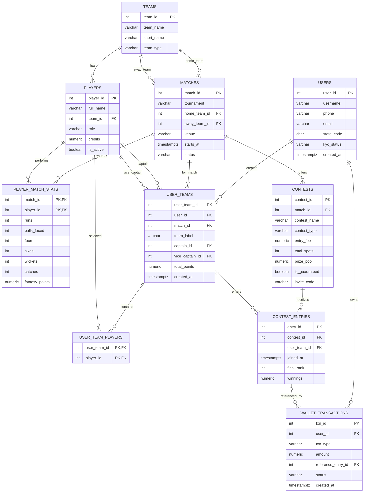

# 02 — Schema Design

**Project:** Dream11 Fantasy Sports Database  
**Database:** PostgreSQL 15+  
**Phase:** 2 — Schema and normalization  
**Status:** Initial design draft — validate against the complete CSV files before treating it as final.

> **Important validation note:** This design is based on the project brief, CSV headers and sample rows. The complete CSV contents must be inspected before finalizing nullability, uniqueness, exact allowed-value lists and every `CHECK` constraint. Do not claim that the seed data loads successfully until `02_load_data.sql` has been run and all row counts and integrity checks have passed.

## 1. Design approach

The database will use a dedicated PostgreSQL schema named `dream11`. The ten relational tables correspond to the ten supplied CSV files, and their table and column names must remain unchanged because the provided workload queries reference them directly.

The design uses:
- integer identifiers for entity IDs;
- `NUMERIC` for credits, fees, prize pools, winnings and wallet amounts;
- `TIMESTAMPTZ` for timestamps that include a UTC offset;
- `BOOLEAN` for yes/no fields;
- primary and foreign keys to identify records and preserve relationships;
- `UNIQUE`, `NOT NULL` and `CHECK` constraints where supported by the actual data and business rules.

No performance indexes should be added in this phase other than indexes PostgreSQL creates automatically for primary-key and unique constraints.

## 2. Tables and columns

The types below are proposed PostgreSQL types. Confirm the full CSV values and ranges before finalizing them.

### 2.1 `teams`

Stores real cricket teams (franchises and national teams).

| Column | Proposed type | Proposed constraint | Reason |
|---|---|---|---|
| `team_id` | `INTEGER` | PK, NOT NULL | Identifier of a real team |
| `team_name` | `VARCHAR(100)` | NOT NULL, UNIQUE (verify) | Full team name |
| `short_name` | `VARCHAR(10)` | NOT NULL, UNIQUE (verify) | Short team code used in fixtures and reports |
| `team_type` | `VARCHAR(20)` | NOT NULL, CHECK (verify allowed values) | Distinguishes franchise and national teams |

**Functional dependency:** `team_id → team_name, short_name, team_type`. If `short_name` is confirmed unique in the data and business rules, it is also a candidate key.

### 2.2 `players`

Stores player identity, real-team membership, playing role, fantasy credits and active status.

| Column | Proposed type | Proposed constraint | Reason |
|---|---|---|---|
| `player_id` | `INTEGER` | PK, NOT NULL | Player identifier |
| `full_name` | `VARCHAR(120)` | NOT NULL | Player's displayed name; names need not be unique |
| `team_id` | `INTEGER` | FK → `teams.team_id`, NOT NULL | Real team to which the player belongs |
| `role` | `VARCHAR(10)` | NOT NULL, CHECK (verify allowed values) | Playing role, e.g. WK |
| `credits` | `NUMERIC(4,1)` | NOT NULL, CHECK (positive and within observed range) | Fantasy-team credit cost |
| `is_active` | `BOOLEAN` | NOT NULL | Whether the player is currently selectable |

**Functional dependency:** `player_id → full_name, team_id, role, credits, is_active`.

### 2.3 `matches`

Stores real cricket fixtures and their scheduling/status information.

| Column | Proposed type | Proposed constraint | Reason |
|---|---|---|---|
| `match_id` | `INTEGER` | PK, NOT NULL | Match identifier |
| `tournament` | `VARCHAR(80)` | NOT NULL | Tournament/series name |
| `home_team_id` | `INTEGER` | FK → `teams.team_id`, NOT NULL | First participating team |
| `away_team_id` | `INTEGER` | FK → `teams.team_id`, NOT NULL | Second participating team |
| `venue` | `VARCHAR(150)` | NOT NULL (verify) | Match venue |
| `starts_at` | `TIMESTAMPTZ` | NOT NULL | Match start time with time zone |
| `status` | `VARCHAR(20)` | NOT NULL, CHECK (verify allowed values) | Match lifecycle status |

**Functional dependency:** `match_id → tournament, home_team_id, away_team_id, venue, starts_at, status`.

**Business rule:** `home_team_id <> away_team_id`. This is suitable for a row-level `CHECK`.

### 2.4 `player_match_stats`

Stores each player's performance in a match and the fantasy points calculated from it.

| Column | Proposed type | Proposed constraint | Reason |
|---|---|---|---|
| `match_id` | `INTEGER` | PK part, FK → `matches.match_id`, NOT NULL | Match in which the performance occurred |
| `player_id` | `INTEGER` | PK part, FK → `players.player_id`, NOT NULL | Player who performed |
| `runs` | `INTEGER` | NOT NULL, CHECK >= 0 | Runs scored |
| `balls_faced` | `INTEGER` | NOT NULL, CHECK >= 0 | Balls faced |
| `fours` | `SMALLINT` | NOT NULL, CHECK >= 0 | Number of fours |
| `sixes` | `SMALLINT` | NOT NULL, CHECK >= 0 | Number of sixes |
| `wickets` | `SMALLINT` | NOT NULL, CHECK >= 0 | Wickets taken |
| `catches` | `SMALLINT` | NOT NULL, CHECK >= 0 | Catches taken |
| `fantasy_points` | `NUMERIC(8,1)` | NOT NULL (verify) | Calculated fantasy score |

**Primary key:** `(match_id, player_id)`, because one player should have at most one aggregate statistics row per match.

**Functional dependency:** `(match_id, player_id) → runs, balls_faced, fours, sixes, wickets, catches, fantasy_points`.

### 2.5 `users`

Stores Dream11 user profile and compliance-related information.

| Column | Proposed type | Proposed constraint | Reason |
|---|---|---|---|
| `user_id` | `INTEGER` | PK, NOT NULL | User identifier |
| `username` | `VARCHAR(50)` | NOT NULL, UNIQUE (verify) | Login/display handle |
| `phone` | `VARCHAR(20)` | NOT NULL, UNIQUE (verify) | Phone numbers are identifiers, not quantities |
| `email` | `VARCHAR(254)` | NULL allowed; UNIQUE when present (verify) | Email may be absent in some records |
| `state_code` | `CHAR(2)` | NOT NULL, CHECK format (verify) | State/territory code used by compliance queries |
| `kyc_status` | `VARCHAR(20)` | NOT NULL, CHECK (verify allowed values) | KYC verification state |
| `created_at` | `TIMESTAMPTZ` | NOT NULL | Account creation time |

**Functional dependency:** `user_id → username, phone, email, state_code, kyc_status, created_at`. Candidate keys such as `username` and `phone` must be confirmed against the full data before applying uniqueness.

### 2.6 `user_teams`

Stores each fantasy team created by a user for a match.

| Column | Proposed type | Proposed constraint | Reason |
|---|---|---|---|
| `user_team_id` | `INTEGER` | PK, NOT NULL | Fantasy-team identifier |
| `user_id` | `INTEGER` | FK → `users.user_id`, NOT NULL | Owner of the fantasy team |
| `match_id` | `INTEGER` | FK → `matches.match_id`, NOT NULL | Match for which the team was created |
| `team_label` | `VARCHAR(20)` | NOT NULL | User-visible label such as T1 |
| `captain_id` | `INTEGER` | FK → `players.player_id`, NOT NULL | Captain; receives 2× points |
| `vice_captain_id` | `INTEGER` | FK → `players.player_id`, NOT NULL | Vice-captain; receives 1.5× points |
| `total_points` | `NUMERIC(10,1)` | NULL allowed (verify) | Stored team score; may not be calculated yet |
| `created_at` | `TIMESTAMPTZ` | NOT NULL | Team creation time |

**Functional dependency:** `user_team_id → user_id, match_id, team_label, captain_id, vice_captain_id, total_points, created_at`.

**Candidate uniqueness to verify:** `(user_id, match_id, team_label)` may be unique if labels are unique per user's match.

**Business rules:** captain and vice-captain must differ; both must be among the 11 selected players, and both players must belong to one of the two real teams in the match. Cross-table membership and match eligibility cannot be enforced by an ordinary row-level `CHECK`.

### 2.7 `user_team_players`

Associative table connecting fantasy teams to their selected players.

| Column | Proposed type | Proposed constraint | Reason |
|---|---|---|---|
| `user_team_id` | `INTEGER` | PK part, FK → `user_teams.user_team_id`, NOT NULL | Fantasy team |
| `player_id` | `INTEGER` | PK part, FK → `players.player_id`, NOT NULL | Selected player |

**Primary key:** `(user_team_id, player_id)`. This prevents the same player from appearing twice in one fantasy team.

**Functional dependency:** `(user_team_id, player_id) →` no other non-key attributes. The relation is an associative relation with a composite key.

The rule that each team must contain exactly 11 players is an aggregate rule across rows. It requires a deferred/constraint-trigger strategy or an application/transaction-level validation; a normal `CHECK` constraint cannot count related rows.

### 2.8 `contests`

Stores contests available for a match.

| Column | Proposed type | Proposed constraint | Reason |
|---|---|---|---|
| `contest_id` | `INTEGER` | PK, NOT NULL | Contest identifier |
| `match_id` | `INTEGER` | FK → `matches.match_id`, NOT NULL | Match associated with contest |
| `contest_name` | `VARCHAR(120)` | NOT NULL | Contest display name |
| `contest_type` | `VARCHAR(20)` | NOT NULL, CHECK (verify allowed values) | Contest category |
| `entry_fee` | `NUMERIC(10,2)` | NOT NULL, CHECK >= 0 | Amount charged to enter |
| `total_spots` | `INTEGER` | NOT NULL, CHECK > 0 | Contest capacity |
| `prize_pool` | `NUMERIC(12,2)` | NOT NULL, CHECK >= 0 | Advertised total prize pool |
| `is_guaranteed` | `BOOLEAN` | NOT NULL | Whether the contest is guaranteed |
| `invite_code` | `VARCHAR(50)` | NULL/empty handling to verify; partial UNIQUE if appropriate | Invitation code for private contests |

**Functional dependency:** `contest_id → match_id, contest_name, contest_type, entry_fee, total_spots, prize_pool, is_guaranteed, invite_code`.

The brief says invite codes may be empty. PostgreSQL treats an empty string and `NULL` as different values, so inspect the CSV and use a partial unique index or a normalized representation only if permitted by the assignment. Do not assume `UNIQUE(invite_code)` is valid without checking the empty values.

### 2.9 `contest_entries`

Stores the fantasy teams entered into contests, including rank and winnings.

| Column | Proposed type | Proposed constraint | Reason |
|---|---|---|---|
| `entry_id` | `INTEGER` | PK, NOT NULL | Contest-entry identifier |
| `contest_id` | `INTEGER` | FK → `contests.contest_id`, NOT NULL | Contest joined |
| `user_team_id` | `INTEGER` | FK → `user_teams.user_team_id`, NOT NULL | Fantasy team entered |
| `joined_at` | `TIMESTAMPTZ` | NOT NULL | Entry time |
| `final_rank` | `INTEGER` | NULL allowed until finalized; CHECK > 0 when present | Final position |
| `winnings` | `NUMERIC(12,2)` | NULL/zero handling to verify; CHECK >= 0 when present | Prize amount awarded |

**Functional dependency:** `entry_id → contest_id, user_team_id, joined_at, final_rank, winnings`.

**Candidate uniqueness:** `(contest_id, user_team_id)` should be unique; the supplied W02 query uses `ON CONFLICT (contest_id, user_team_id) DO NOTHING`, so this unique constraint is required by the workload. This prevents the same fantasy team from entering the same contest twice. It does not, by itself, prevent a user from entering multiple different teams into the same contest.

### 2.10 `wallet_transactions`

Stores the wallet ledger for deposits, entry fees, winnings, refunds, bonuses and withdrawals.

| Column | Proposed type | Proposed constraint | Reason |
|---|---|---|---|
| `txn_id` | `INTEGER` | PK, NOT NULL | Wallet transaction identifier |
| `user_id` | `INTEGER` | FK → `users.user_id`, NOT NULL | Wallet owner |
| `txn_type` | `VARCHAR(20)` | NOT NULL, CHECK (verify allowed values) | Transaction category |
| `amount` | `NUMERIC(12,2)` | NOT NULL, CHECK > 0 (verify sign convention) | Exact monetary amount |
| `reference_entry_id` | `INTEGER` | NULL allowed; FK → `contest_entries.entry_id` | Links entry-related transactions to a contest entry |
| `status` | `VARCHAR(20)` | NOT NULL, CHECK (verify allowed values) | Transaction processing state |
| `created_at` | `TIMESTAMPTZ` | NOT NULL | Transaction timestamp |

**Functional dependency:** `txn_id → user_id, txn_type, amount, reference_entry_id, status, created_at`.

The reference is nullable because deposits and other non-entry transactions may not refer to a contest entry. The exact relationship between transaction types and `reference_entry_id` must be derived from all rows before adding a cross-column `CHECK`.

## 3. Primary keys and foreign-key relationships

| Child table / column | Parent table / column | Relationship | Initial delete policy |
|---|---|---|---|
| `players.team_id` | `teams.team_id` | One team has many players (1:N) | RESTRICT |
| `matches.home_team_id` | `teams.team_id` | One team can be home team in many matches (1:N) | RESTRICT |
| `matches.away_team_id` | `teams.team_id` | One team can be away team in many matches (1:N) | RESTRICT |
| `player_match_stats.match_id` | `matches.match_id` | One match has many player-stat rows (1:N) | CASCADE may be suitable for dependent stats; confirm policy |
| `player_match_stats.player_id` | `players.player_id` | One player has many match-stat rows (1:N) | RESTRICT |
| `user_teams.user_id` | `users.user_id` | One user creates many fantasy teams (1:N) | RESTRICT |
| `user_teams.match_id` | `matches.match_id` | One match has many fantasy teams (1:N) | RESTRICT |
| `user_teams.captain_id` | `players.player_id` | A player can captain many fantasy teams (1:N) | RESTRICT |
| `user_teams.vice_captain_id` | `players.player_id` | A player can be vice-captain of many fantasy teams (1:N) | RESTRICT |
| `user_team_players.user_team_id` | `user_teams.user_team_id` | One fantasy team has many selected-player rows (1:N) | CASCADE is reasonable for its dependent rows |
| `user_team_players.player_id` | `players.player_id` | One player can be selected in many fantasy teams (1:N) | RESTRICT |
| `contests.match_id` | `matches.match_id` | One match has many contests (1:N) | RESTRICT |
| `contest_entries.contest_id` | `contests.contest_id` | One contest has many entries (1:N) | RESTRICT |
| `contest_entries.user_team_id` | `user_teams.user_team_id` | One fantasy team can enter many contests (1:N) | RESTRICT |
| `wallet_transactions.user_id` | `users.user_id` | One user has many wallet transactions (1:N) | RESTRICT |
| `wallet_transactions.reference_entry_id` | `contest_entries.entry_id` | An entry may be referenced by related ledger transactions (1:N, optional) | SET NULL or RESTRICT; decide after audit/retention requirements |

**Delete-policy rationale:** Historical financial and contest records should not disappear when a user, match, contest or player is removed. Therefore, `RESTRICT` is the conservative default for business/history tables. `CASCADE` is limited to dependent detail rows where deleting the owning record is explicitly intended. The wallet-to-entry delete policy needs a deliberate audit-retention decision; `SET NULL` preserves the transaction but removes the link, while `RESTRICT` protects the reference.

## 4. Candidate constraints to validate

The following are candidates, not a claim that every rule has already been validated against the complete CSV exports.

1. Every primary-key column is `NOT NULL` and unique.
2. `teams.team_name` is not null; uniqueness should be checked.
3. `teams.short_name` is not null; uniqueness should be checked.
4. `players.credits > 0` and within the observed business range.
5. `matches.home_team_id <> matches.away_team_id`.
6. `player_match_stats.runs >= 0`.
7. `player_match_stats.balls_faced >= 0`.
8. `player_match_stats.fours >= 0`.
9. `player_match_stats.sixes >= 0`.
10. `player_match_stats.wickets >= 0`.
11. `player_match_stats.catches >= 0`.
12. `user_teams.captain_id <> user_teams.vice_captain_id`.
13. `contests.entry_fee >= 0`.
14. `contests.total_spots > 0`.
15. `contests.prize_pool >= 0`.
16. `contest_entries.final_rank IS NULL OR final_rank > 0`.
17. `contest_entries.winnings IS NULL OR winnings >= 0`.
18. `UNIQUE(contest_id, user_team_id)` on `contest_entries`.
19. `wallet_transactions.amount > 0` if the CSV stores the amount as a positive magnitude and transaction type determines the direction.
20. Allowed values for `players.role`, `teams.team_type`, `matches.status`, `users.kyc_status`, `contests.contest_type`, `wallet_transactions.txn_type` and `wallet_transactions.status`, after extracting their distinct values from the CSVs.
21. Username, phone, email and non-empty invite-code uniqueness, after checking duplicates and null/empty-value patterns.

**Rules that a simple `CHECK` cannot enforce across tables/rows:**
- exactly 11 selected players per fantasy team;
- total selected-player credits not exceeding 100;
- at most 7 selected players from either real team;
- captain and vice-captain must be selected in that fantasy team;
- all selected players must belong to one of the match's two participating teams;
- a user must not enter more than one team into the same contest (if that is the intended fair-play rule);
- one paid contest entry must have exactly one matching entry-fee debit.

These require a trigger, transaction/application validation, or an integrity-audit query. Do not try to enforce them using a row-level `CHECK`.

## 5. Relationships and ER diagram

The principal relationships are:
- `teams` 1:N `players`;
- `teams` 1:N `matches` through both home-team and away-team foreign keys;
- `matches` M:N `players` through `player_match_stats`;
- `users` 1:N `user_teams`;
- `matches` 1:N `user_teams`;
- `user_teams` M:N `players` through `user_team_players`;
- `matches` 1:N `contests`;
- `contests` M:N `user_teams` through `contest_entries`;
- `users` 1:N `wallet_transactions`;
- `contest_entries` 1:N optional wallet references through `wallet_transactions.reference_entry_id`.



## 6. Normalization and functional-dependency analysis

### First Normal Form (1NF)

All ten tables have named columns and scalar values. The many players selected by a fantasy team are not stored as a list in `user_teams`; they are represented as separate rows in `user_team_players`. The composite key `(user_team_id, player_id)` identifies each selected-player association.

### Second Normal Form (2NF)

Tables with single-column primary keys are in 2NF because no non-key attribute can depend on only part of a single-column key. The two composite-key tables are also designed to satisfy 2NF:
- In `player_match_stats`, each performance attribute depends on the complete key `(match_id, player_id)`, not on match alone or player alone.
- In `user_team_players`, there are no non-key attributes that could depend on only one part of the composite key.

### Third Normal Form (3NF) and BCNF

The intended determinant in each table is its primary key (and any verified candidate key). Descriptive attributes are stored with the entity they describe. For example, `team_name` is stored in `teams`, not repeated as a descriptive column in every player or match row. `username` and other user details are stored in `users`, not repeated in wallet or contest-entry rows.

Under the functional dependencies listed in the table sections, each determinant is a candidate key; therefore, the proposed relations are intended to satisfy BCNF. This conclusion must be revisited if CSV inspection reveals additional dependencies or if a proposed unique candidate key is not actually unique.

### Derived or potentially redundant attributes

| Attribute | Why it may be derived | Reason it may still be stored |
|---|---|---|
| `player_match_stats.fantasy_points` | It may be calculated from runs, balls faced, fours, sixes, wickets, catches and the platform's scoring rules. | Storing the calculated score avoids recalculating it for every preview/report and preserves the score produced by the scoring rules used at the time. The scoring formula is not included in the CSV brief, so it must not be invented here. |
| `user_teams.total_points` | It can be calculated from the fantasy points of the 11 selected players, applying 2× to the captain and 1.5× to the vice-captain. | It supports fast team previews and leaderboards. The points engine can recompute it when player scores change. |
| `contests.prize_pool` | It might appear related to `entry_fee × total_spots`. | The actual prize pool may include guarantees, platform contributions, fees or other rules. The sample data does not prove a fixed formula, so it should be retained as an independent stored value unless the business rules establish otherwise. |

These fields are deliberate potential denormalizations for read performance or historical correctness. Their values should be kept consistent by the application or points/contest processing logic.

## 7. Seed-data loading and verification plan

Load parent tables before dependent tables in this order:

1. `teams`
2. `players`
3. `matches`
4. `users`
5. `player_match_stats`
6. `user_teams`
7. `contests`
8. `user_team_players`
9. `contest_entries`
10. `wallet_transactions`

The exact order may be adjusted if the final foreign-key definitions require it. The load script should use `\copy` with CSV headers and finish with `ANALYZE`.

### Expected row counts from the project brief

| CSV / table | Expected rows |
|---|---:|
| `teams` | 18 |
| `players` | 450 |
| `matches` | 212 |
| `player_match_stats` | 4,444 |
| `users` | 50,000 |
| `user_teams` | 39,975 |
| `user_team_players` | 439,925 |
| `contests` | 2,544 |
| `contest_entries` | 42,746 |
| `wallet_transactions` | 118,343 |

### Integrity checks to run after loading

The following are proposed checks. Record the actual query output and interpretation after executing them; do not fill in expected results as if they were measured.

**Check 1 — Every fantasy team has exactly 11 distinct players**

```sql
SELECT ut.user_team_id, COUNT(utp.player_id) AS player_count
FROM dream11.user_teams AS ut
LEFT JOIN dream11.user_team_players AS utp
  ON utp.user_team_id = ut.user_team_id
GROUP BY ut.user_team_id
HAVING COUNT(utp.player_id) <> 11;
```

Expected interpretation: no rows should be returned if every team is complete.

**Check 2 — Selected players belong to one of the match's two real teams**

```sql
SELECT ut.user_team_id, p.player_id, p.team_id
FROM dream11.user_teams AS ut
JOIN dream11.matches AS m
  ON m.match_id = ut.match_id
JOIN dream11.user_team_players AS utp
  ON utp.user_team_id = ut.user_team_id
JOIN dream11.players AS p
  ON p.player_id = utp.player_id
WHERE p.team_id NOT IN (m.home_team_id, m.away_team_id);
```

Expected interpretation: no rows should be returned if all fantasy-team selections are eligible for their match.

**Check 3 — No fantasy team was created after its match started**

```sql
SELECT ut.user_team_id, ut.created_at, m.starts_at
FROM dream11.user_teams AS ut
JOIN dream11.matches AS m
  ON m.match_id = ut.match_id
WHERE ut.created_at >= m.starts_at;
```

Expected interpretation: inspect any returned rows; the business rule may require a strict pre-lock time rather than merely before the scheduled start.

**Additional audit — paid entries without an entry-fee debit**

```sql
SELECT ce.entry_id, ce.contest_id, ce.joined_at
FROM dream11.contest_entries AS ce
JOIN dream11.contests AS c
  ON c.contest_id = ce.contest_id
WHERE c.entry_fee > 0
  AND NOT EXISTS (
    SELECT 1
    FROM dream11.wallet_transactions AS w
    WHERE w.reference_entry_id = ce.entry_id
      AND w.txn_type = 'ENTRY_FEE'
      AND w.status = 'SUCCESS'
  );
```

Expected interpretation: investigate any returned entries. This check should be compared with the supplied R13 workload and the actual ledger semantics.

### Actual verification results

| Verification | Result |
|---|---|
| All 10 tables created | Pending execution |
| All expected row counts match | Pending CSV load |
| Check 1: exactly 11 players per team | Pending execution |
| Check 2: players belong to match teams | Pending execution |
| Check 3: team created before match start | Pending execution |
| Paid-entry wallet audit | Pending execution |

## 8. Data issues and decisions to confirm

Before finalizing `01_schema.sql`, inspect the actual CSVs for:
- null and empty-string counts for every column, especially `email`, `total_points`, `final_rank`, `invite_code` and `reference_entry_id`;
- distinct values for all categorical columns (`team_type`, `role`, `status`, `contest_type`, `txn_type`, `kyc_status`);
- duplicate values in candidate unique columns (`team_name`, `short_name`, `username`, `phone`, non-empty `email`, non-empty `invite_code`);
- duplicate key combinations in `player_match_stats`, `user_team_players` and `contest_entries`;
- negative, zero and out-of-range values for credits, statistics, amounts, spots, winnings and ranks;
- whether the wallet ledger stores positive amounts with direction determined by `txn_type`;
- whether every entry-fee transaction has a reference and whether any non-entry transaction has one.

Any constraint that rejects a supplied seed row must be investigated. Do not silently delete or modify seed records to make the load succeed.

## 9. Conclusion

The proposed relational model contains ten tables matching the ten CSV exports. It separates real cricket entities, user-created fantasy teams, contest participation and wallet ledger records, while using associative tables for many-to-many relationships. The design identifies candidate keys, relationships, normalization dependencies, derived attributes and cross-row business rules.

The next step is to inspect the complete seed CSV files, finalize the constraints from observed data, implement `sql/01_schema.sql` and `sql/02_load_data.sql`, then replace the pending verification entries with actual results.
